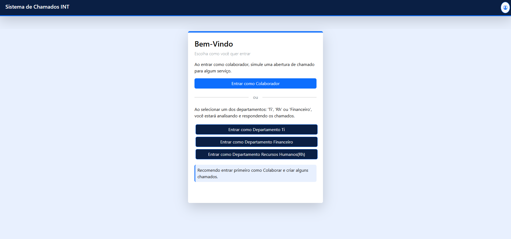
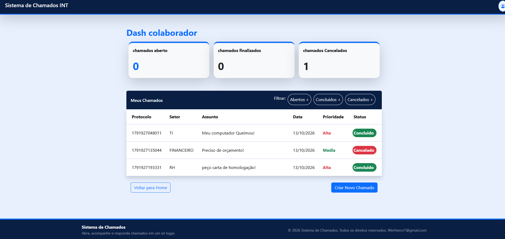

# 🎫 Sistema de Chamados

Sistema web para abertura e acompanhamento de chamados internos. O colaborador registra o problema, escolhe o setor responsável e a prioridade, e acompanha tudo pelo painel.

🔗 **Demo:** https://werthercrisley.github.io/Sistema-De-Chamados-Corporativos/

---

## 📸 Preview




---

## ✨ Funcionalidades

- **Login** por perfil: colaborador e departamentos (TI, Financeiro e RH)
- **Dashboard do colaborador** com a lista dos chamados abertos
- **Criar chamado** com título, contato e descrição
- **Setor e prioridade** escolhidos em uma subpágina própria
- Botões de **voltar** e **enviar** em cada etapa
- Chamados salvos no navegador (`localStorage`), com:
  - id
  - título
  - contato
  - status
  - descrição
  - setor
  - prioridade
  - data de criação
- Interface responsiva em tons de **azul, branco e preto**

---

## 🛠️ Tecnologias

| Área | Tecnologia |
|---|---|
| Frontend | React + Vite |
| Estilização | Bootstrap |
| Armazenamento | localStorage |
| Deploy | GitHub Pages |

---

## 📁 Estrutura do projeto

```
src/
├── components/
├── pages/
│   ├── home/
│   ├── colaborador/
│   └── esqueletoChamado/
│   └── suporte/
├── App.jsx
└── main.jsx
└── index.css
```

> Ajuste essa estrutura para refletir as pastas reais do seu projeto.

---

## 🚀 Como rodar localmente

**Pré-requisitos:** [Node.js](https://nodejs.org) 18 ou superior e Git.

```bash
# 1. Clonar o repositório
git clone https://github.com/WertherCrisley/NOME-DO-REPO.git

# 2. Entrar na pasta
cd SistemChamados

# 3. Instalar as dependências
npm install

# 4. Rodar em modo desenvolvimento
npm run dev
```

Acesse `http://localhost:5173`.

### Outros comandos

```bash
npm run build     # gera a versão de produção na pasta dist
npm run preview   # testa o build localmente
npm run deploy    # publica no GitHub Pages (se usar gh-pages)
```

---

## 🌐 Deploy no GitHub Pages

1. Configure o `base` no `vite.config.js`:
   ```js
   export default defineConfig({
     plugins: [react()],
     base: '/Sistema-De-Chamados-Corporativos/',
   })
   ```
2. Se usar rotas, prefira o `HashRouter` (o GitHub Pages não lida com rotas do `BrowserRouter` ao recarregar a página).
3. Rode `npm run deploy` ou use o workflow do GitHub Actions.
4. Em **Settings → Pages**, selecione a fonte de publicação.

---

## 💾 Como os dados são salvos

Os chamados ficam no `localStorage` do navegador, na chave `chamados`. Exemplo de um registro:

```json
{
  "id": 1,
  "titulo": "Computador não liga",
  "contato": "(85) 99999-xxxx",
  "status": "Aberto",
  "descricao": "O computador da recepção não liga desde ontem.",
  "setor": "TI",
  "prioridade": "Alta",
  "data": "2026-10-04T10:30:00.000Z"
}
```

⚠️ Como os dados ficam só no navegador, eles não são compartilhados entre usuários nem entre dispositivos. Limpar os dados do site apaga os chamados.

---

## 🗺️ Próximos passos

- [ ] Backend com Node.js, Express e Prisma para salvar os chamados em banco de dados
- [ ] Autenticação real (JWT)
- [ ] Painel para TI, Financeiro e RH responderem e alterarem o status
- [ ] Filtros por status, setor e prioridade
- [ ] Notificações de atualização do chamado

---

## 🤝 Contribuindo

1. Faça um fork do projeto
2. Crie uma branch: `git checkout -b feature/minha-feature`
3. Commit: `git commit -m "feat: minha feature"`
4. Push: `git push origin feature/minha-feature`
5. Abra um Pull Request

---

## 👤 Autor

**Werther Crisley**

- GitHub: [@WertherCrisley](https://github.com/WertherCrisley)

---

## 📄 Licença

Este projeto está sob a licença MIT. Veja o arquivo `LICENSE` para mais detalhes.

